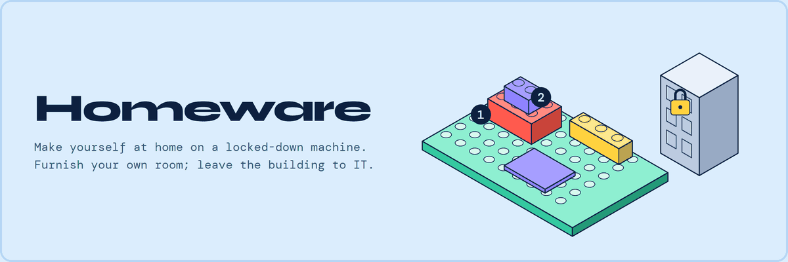
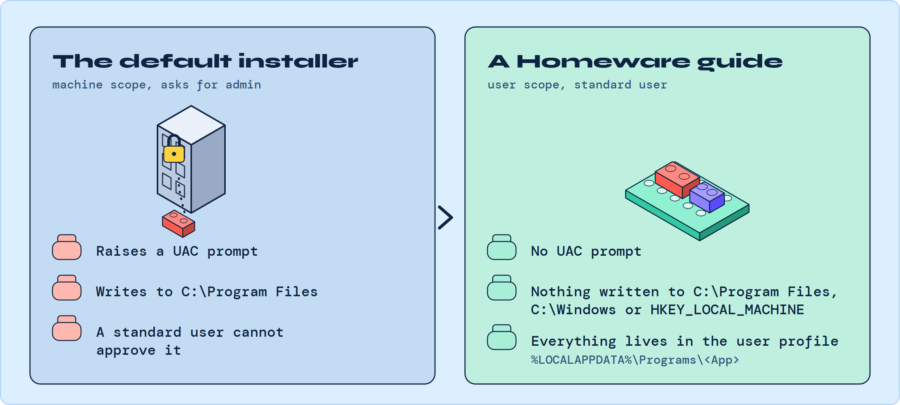
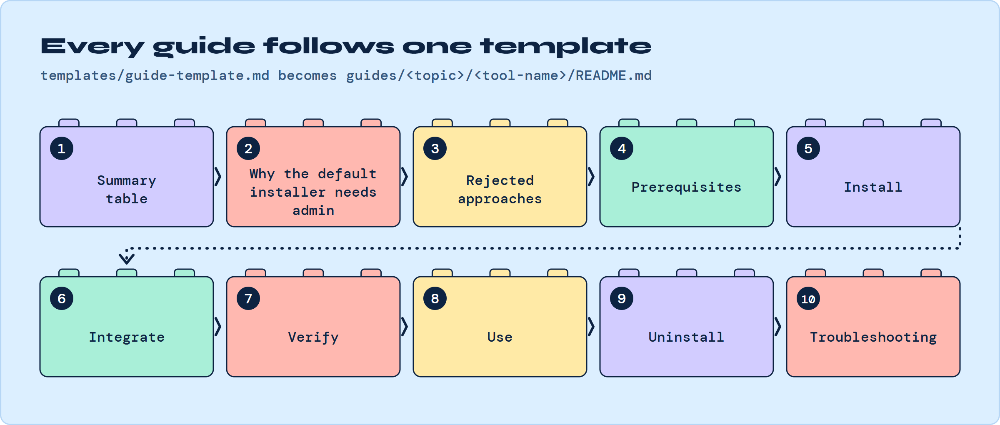
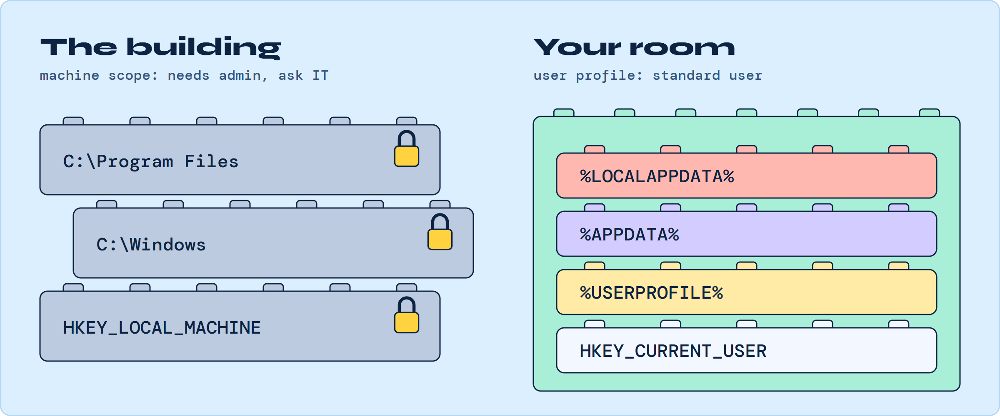
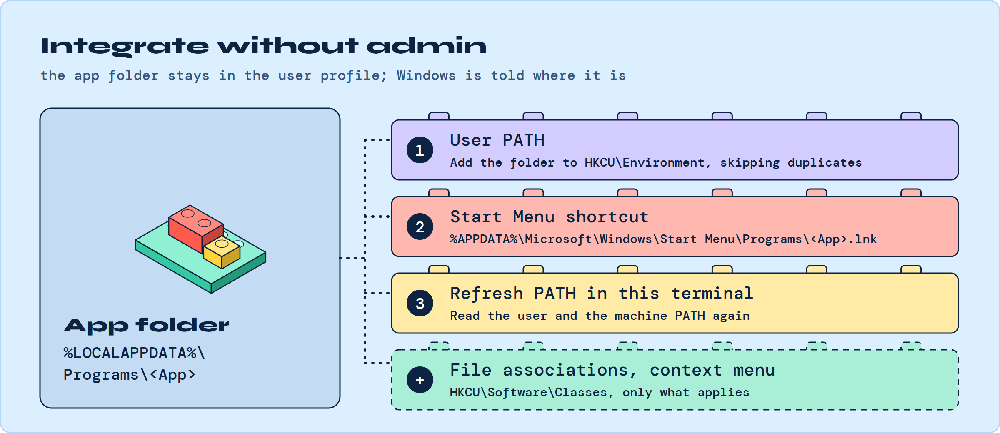

<h1 align="center"><picture><source media="(prefers-color-scheme: dark)" srcset="assets/readme/hero-dark.gif"></picture></h1>

<p align="center">
<a href="#guides"><picture><source media="(prefers-color-scheme: dark)" srcset="assets/readme/btn-guides-dark.webp"></picture></a>
<a href="#ground-rules"><picture><source media="(prefers-color-scheme: dark)" srcset="assets/readme/btn-rules-dark.webp"></picture></a>
<a href="#general-techniques"><picture><source media="(prefers-color-scheme: dark)" srcset="assets/readme/btn-techniques-dark.webp"></picture></a>
<a href="#contributing"><picture><source media="(prefers-color-scheme: dark)" srcset="assets/readme/btn-contributing-dark.webp"></picture></a>
</p>

Homeware is a registry of step-by-step guides for installing developer tools on Windows as a **standard user** - no administrator rights, no UAC prompt, nothing written to `C:\Program Files`, `C:\Windows` or `HKEY_LOCAL_MACHINE`.

Guides include only steps that were run as a standard user. A step taken from vendor docs and not tested says so in the guide.

<picture><source media="(prefers-color-scheme: dark)" srcset="assets/readme/problem-dark.webp"></picture>

## Guides

<picture><source media="(prefers-color-scheme: dark)" srcset="assets/readme/guide-dark.webp"></picture>

### agents

| Tool | Method | Tested version | Guide |
|---|---|---|---|
| Claude Code status line | User settings + Bash script, jq via `winget --scope user` | Claude Code 2.1.302, jq 1.8.2 | [guides/agents/claude-code-statusline](guides/agents/claude-code-statusline/README.md) |
| GitLab MCP server | `npx`, no global install | - | [guides/agents/gitlab-mcp](guides/agents/gitlab-mcp/README.md) |

### cloud

| Tool | Method | Tested version | Guide |
|---|---|---|---|
| AWS CLI v2 + SSO | `msiexec /a` administrative install + `sso-session` config | 2.36.x | [guides/cloud/aws-cli-v2-sso](guides/cloud/aws-cli-v2-sso/README.md) |
| Floci CLI | Official installer script, user scope | 0.2.2 | [guides/cloud/floci](guides/cloud/floci/README.md) |

### containers

| Tool | Method | Tested version | Guide |
|---|---|---|---|
| Crane | Portable archive, SHA256 verified | 0.22.1 | [guides/containers/crane](guides/containers/crane/README.md) |
| Docker Engine in WSL2 + Portainer | WSL2 distro + Docker apt repository, Portainer CE as GUI | 29.9.0 | [guides/containers/docker-engine-wsl](guides/containers/docker-engine-wsl/README.md) |

### devops-tools

| Tool | Method | Tested version | Guide |
|---|---|---|---|
| Ansible dev tools in WSL2 | `uv` tarball (SHA256 verified) + `uv tool install` inside a WSL2 distro | ansible-dev-tools 26.11.0, Checkov 3.4.3 | [guides/devops-tools/ansible-dev-tools-wsl](guides/devops-tools/ansible-dev-tools-wsl/README.md) |
| GitHub CLI | Portable zip, SHA256 verified | 2.102.0 | [guides/devops-tools/github-cli](guides/devops-tools/github-cli/README.md) |
| Trivy | `winget --scope user` | 0.74.0 | [guides/devops-tools/trivy](guides/devops-tools/trivy/README.md) |

### editors

| Tool | Method | Tested version | Guide |
|---|---|---|---|
| Sublime Text 4 | Portable zip + `HKCU` integration | Build 4213 | [guides/editors/sublime-text-4](guides/editors/sublime-text-4/README.md) |
| VS Code startup layout + Claude Code | User settings + per-user Auto Run Command extension | VS Code 1.142.0 | [guides/editors/vscode-claude-code-startup](guides/editors/vscode-claude-code-startup/README.md) |

### languages

| Tool | Method | Tested version | Guide |
|---|---|---|---|
| Go + Wails 3 CLI | Portable zip, SHA256 verified + `go install` | Go 1.27.2, Wails v3.0.0-beta.30 | [guides/languages/go-wails3](guides/languages/go-wails3/README.md) |
| Rust + Tauri 2 | `rustup-init` + portable MSVC and Windows SDK (`msiexec /a`) + npm Tauri CLI | Rust 1.100.0, Tauri CLI 2.12.5 | [guides/languages/rust-tauri](guides/languages/rust-tauri/README.md) |
| uv | Official installer script, reviewed first, user scope | 0.13.9 | [guides/languages/uv](guides/languages/uv/README.md) |

### media

| Tool | Method | Tested version | Guide |
|---|---|---|---|
| OBS Studio | Portable zip, SHA256 verified | 33.0.0 | [guides/media/obs-studio](guides/media/obs-studio/README.md) |

## Ground rules

<picture><source media="(prefers-color-scheme: dark)" srcset="assets/readme/rules-dark.webp"></picture>

- Everything lives in the user profile: `%LOCALAPPDATA%`, `%APPDATA%`, `%USERPROFILE%` and `HKEY_CURRENT_USER`.
- These guides use features Windows provides for per-user installs. They **do not** bypass UAC, disable security controls or exploit anything. If a tool genuinely needs admin rights (drivers, services, Docker Desktop, Hyper-V/WSL), ask your IT team instead.
- Respect your organization's software policy. "Can be installed without admin" is not the same as "is allowed to be installed".

## General techniques

Try these in order. Each guide says which one it uses and why the others did not work.

<picture><source media="(prefers-color-scheme: dark)" srcset="assets/readme/techniques-dark.webp"></picture>

<details>
<summary>The same techniques as a table, with an example for each</summary>

| Technique | When it works | Example |
|---|---|---|
| `winget install --id <id> --scope user` | The package has a user-scope installer | `winget install --id AquaSecurity.Trivy --scope user` |
| Official portable zip | The vendor ships a zip build | Extract to `%LOCALAPPDATA%\Programs\<App>` |
| Administrative install, `msiexec /a <file>.msi /qn TARGETDIR=<dir>` | Only a machine-wide MSI exists and the app is self-contained | AWS CLI v2 |
| Language package managers in user mode | CLI tools published to npm, PyPI, etc. | `uv tool install <pkg>`, `npx -y <pkg>`, `npm` with a user prefix |
| Per-user installer scripts | The vendor script installs under the user profile | Download, read, then run - never pipe unknown scripts straight into `iex` |

</details>

<picture><source media="(prefers-color-scheme: dark)" srcset="assets/readme/integrate-dark.webp"></picture>

Integration without admin:

```powershell
# Add a folder to the user PATH (HKCU\Environment)
$dir = "$env:LOCALAPPDATA\Programs\<App>"
$p = [Environment]::GetEnvironmentVariable("Path", "User")
if (($p -split ';') -notcontains $dir) { [Environment]::SetEnvironmentVariable("Path", "$p;$dir", "User") }

# Start Menu shortcut for the current user
$sc = (New-Object -ComObject WScript.Shell).CreateShortcut("$env:APPDATA\Microsoft\Windows\Start Menu\Programs\<App>.lnk")
$sc.TargetPath = "$dir\<app>.exe"; $sc.Save()

# Refresh PATH in the current terminal
$env:Path = [Environment]::GetEnvironmentVariable("Path", "User") + ";" + [Environment]::GetEnvironmentVariable("Path", "Machine")
```

File associations and context-menu entries go under `HKCU\Software\Classes` - see the [Sublime Text guide](guides/editors/sublime-text-4/README.md) for a full example.

## Contributing

<picture><source media="(prefers-color-scheme: dark)" srcset="assets/readme/contribute-dark.webp"></picture>

See [CONTRIBUTING.md](CONTRIBUTING.md) and start from [templates/guide-template.md](templates/guide-template.md).

## License

[MIT](LICENSE). The guides are provided as-is; check each vendor's license terms for the software itself.
